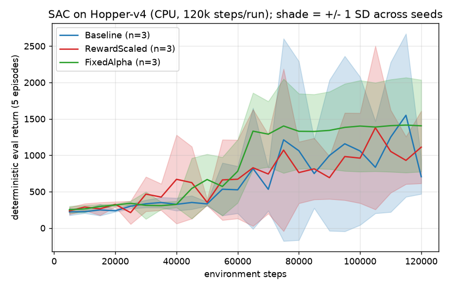
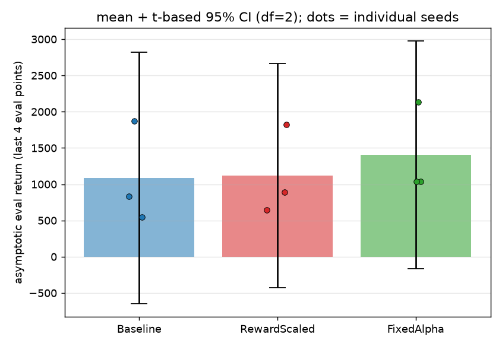

# embodied-offpolicy-study

A small, honest, from-scratch reinforcement-learning study built to demonstrate
real research ability for a PhD (Embodied AI / RL) application.

- **Algorithm**: Soft Actor-Critic (SAC) implemented **from scratch in PyTorch**
  (no Stable-Baselines3). Twin critics, soft target updates, tanh-squashed Gaussian
  actor, automatic entropy temperature.
- **Envs**: Pendulum-v1 (validation) + Hopper-v4 (the study).
- **Study**: does critic-side **reward scaling** (0.1 vs 1.0) change sample
  efficiency / asymptotic return? 3 seeds per arm, plus a fixed-alpha control.
  Pre-registered in `PRE_REGISTRATION.md`.
- **Hardware honesty**: all runs are **CPU only**, **120k env steps per run**
  (restored to the pre-registered budget). This is *not* a 1M-step benchmark;
  numbers are reported as measured.
- **Static notes site**: an academic-style write-up of this null result and the
  companion deployment-toolkit pitfall taxonomy lives under [`docs/`](docs/)
  (zero-build HTML; open `docs/index.html`, or serve `docs/` with any static
  file server).

## Layout

```
src/            from-scratch SAC (replay buffer, actor, twin critic, agent)
tests/          pytest: buffer sampling, actor bounds/logprob & rescale Jacobian, critic shapes,
                one SAC update step, reward_scale scaling, scipy stats, Pendulum learn gate,
                train divergence guard, plot grid/non-finite guards
configs/        YAML per setting (pendulum_ci, pendulum, hopper baseline/rewardscale/fixedalpha)
train.py        training loop -> logs/<run>/progress.csv (per-episode + eval rows)
ci_check.py     fast Pendulum learn-gate used by CI
plot.py         reads raw CSVs -> learning curve + asymptotic bar chart + Welch/ANOVA
logs/<run>/progress.csv   RAW step logs (committed, not fabricated)
figures/        plots produced by plot.py
PRE_REGISTRATION.md       hypothesis registered before results
RESEARCH_RETRO.md         short human-readable write-up
```

## Prerequisites (read first)

- **Python 3.13 (64-bit).** The committed logs were produced on CPython 3.13.x;
  `requirements.txt` is pinned to that interpreter.
- **CPU only.** Every run in this repo is CPU-only. The pinned torch is
  `2.14.1+cpu` (CUDA disabled). Do **not** `pip install torch` from plain PyPI
  on top of this — that pulls a multi-GB CUDA wheel and does not match the
  committed environment.
- **Windows: clone to a pure-ASCII path.** MuJoCo's native layer cannot resolve
  `hopper.xml` when the repo sits under a path containing non-ASCII characters
  (e.g. `D:\github项目`). Clone/copy this repo to an ASCII-only path such as
  `D:\repos\embodied-offpolicy-study` and run from there. This is a MuJoCo
  path-encoding limitation on Windows, not a bug in this repo's code — see
  [Troubleshooting](#troubleshooting) for the full explanation and the
  one-line verification command.

## Quick start

```powershell
# 0. (Windows) make sure you are inside a pure-ASCII checkout, e.g. D:\repos\embodied-offpolicy-study

# 1. create and activate a fresh virtualenv
python -m venv .venv
.\.venv\Scripts\activate            # Windows PowerShell
# source .venv/bin/activate         # macOS / Linux

# 2. install pinned deps. torch==2.14.1+cpu is fetched from the PyTorch CPU
#    index (https://download.pytorch.org/whl/cpu), which is declared in-file at
#    the top of requirements.txt; everything else comes from PyPI. No extra
#    flags are needed.
pip install -r requirements.txt

# 3. sanity-check the install: torch must report +cpu and no CUDA; Hopper-v4
#    must construct without raising (this is also the non-ASCII-path check).
python -c "import torch, gymnasium as gym; print(torch.__version__); gym.make('Hopper-v4')"

# 4. unit tests
pytest tests/ -q

# 5. validation: prove the agent learns on Pendulum
python train.py --config configs/sac_pendulum.yaml --seed 0 --out logs/pendulum_val_s0

# 6. one arm of the study (repeat for each seed / config)
python train.py --config configs/sac_hopper_baseline.yaml    --seed 0 --out logs/hopper_baseline_s0
python train.py --config configs/sac_hopper_rewardscale.yaml --seed 0 --out logs/hopper_rewardscale_s0
python train.py --config configs/sac_hopper_fixedalpha.yaml  --seed 0 --out logs/hopper_fixedalpha_s0

# 7. plot from the raw CSVs
python plot.py
```

> **Where the torch wheel comes from.** `torch==2.14.1+cpu` is a local version
> that is *not* published on the default PyPI index; it only exists on the
> PyTorch CPU index (`https://download.pytorch.org/whl/cpu`). The `requirements.txt`
> declares `--extra-index-url https://download.pytorch.org/whl/cpu` at its top,
> so the single `pip install -r requirements.txt` command above automatically
> fetches the +cpu wheel from that index and every other package from PyPI.
> (Without that in-file declaration pip fails with "No matching distribution
> found" for torch, because the +cpu wheel is absent from plain PyPI; with a
> bare `torch==2.14.1` pin, pip would instead resolve the multi-GB CUDA wheel
> from PyPI.)

## Troubleshooting

- **Windows: `gym.make('Hopper-v4')` crashes / MuJoCo cannot open `hopper.xml`.**
  If this repository sits under a path containing non-ASCII characters (observed with
  a folder named in Chinese, e.g. `D:\github项目`), MuJoCo's native layer fails to
  resolve `hopper.xml` and `gym.make('Hopper-v4')` raises a model-load error — even
  though `pip install gymnasium[mujoco]` succeeded. This is a MuJoCo path-encoding
  issue on Windows, not a bug in this study's code. **Workaround:** clone or copy the
  repository to a pure-ASCII path (e.g. `D:\repos\embodied-offpolicy-study`) and run
  from there; the same code runs fine once the path is ASCII-only. Quick check:
  `python -c "import gymnasium as gym; gym.make('Hopper-v4')"` should construct
  without raising.

## Actual resolved environment (prereg vs pinned)

`PRE_REGISTRATION.md` names gymnasium 1.3.0 / mujoco 3.14.0 as the planned stack.
The environment that actually produced — and that `requirements.txt` now pins to
reproduce — the committed Hopper CSVs is gymnasium **1.4.0** / mujoco **3.15.0**.
These are minor bumps and Hopper-v4 reward semantics are unchanged across them,
so the numbers are directly comparable. I am leaving `PRE_REGISTRATION.md` as-is:
it is a dated record of what was planned, and rewriting "1.3.0" to "1.4.0" would
be retroediting history. The discrepancy is logged here instead.

## Results

Deterministic eval return (5 episodes), Hopper-v4, CPU, **120k steps/run**, 3 seeds
per arm. Three arms: Baseline (scale=1.0, auto alpha), RewardScaled (scale=0.1,
auto alpha), and FixedAlpha (scale=0.1, alpha frozen at 0.2, no auto-tune — this arm
separates "reward scaling" from "auto-tuned alpha dynamics").

Asymptotic window = **last 4 eval points (105k–120k)** = last 20% of training.

| Arm | asymptotic return (mean ± SD, n=3) |
|---|---|
| Baseline (reward_scale=1.0) | **1085 ± 698** |
| RewardScaled (reward_scale=0.1) | **1118 ± 623** |
| FixedAlpha (auto_tune=off) | **1404 ± 632** |

Per-seed tail means: baseline = 547, 833, 1873; reward-scaled = 645, 886, 1824;
fixed-alpha = 1039, 1039, 2133.

*Footnote:* the per-seed numbers above are a set, not ordered by seed; read in
seed order (s0, s1, s2) they are baseline 547 / 1873 / 833, reward-scaled
645 / 886 / 1824, fixed-alpha 2133 / 1039 / 1039. The two ~1039 fixed-alpha
values are real (seeds 1 and 2 both plateau), not a copy-paste error.

Stats (`python plot.py`, scipy exact distributions; n=3, df=2): the t-based 95% CI
half-widths are ~±1550–1730 (t₀.₉₇₅,₂ = 4.303), showing how little n=3 actually
pins the mean. Pairwise Welch t (`ttest_ind`, equal_var=False): Baseline vs
FixedAlpha p=0.589; Baseline vs RewardScaled p=0.953; FixedAlpha vs RewardScaled
p=0.607. One-way ANOVA (`f_oneway`): F=0.22, p=0.811.

Note: the third arm (FixedAlpha) and the pairwise Welch tests / ANOVA are
exploratory post-hoc analyses (added after the 60k pass, uncorrected for
multiple comparisons); the **pre-registered primary contrast is Baseline vs
RewardScaled**.

**Pre-registered secondary endpoint (early learning at 50k, descriptive only).**
Hypothesis #2 asked for higher eval return at step 50k. Reading the single 50k
eval point per seed from the committed CSVs (recomputed by
`docs/assets/recompute_stats.py`): Baseline ≈ 332 (357.1, 334.5, 303.4),
RewardScaled ≈ 354 (307.5, 368.5, 385.6), FixedAlpha ≈ 667 (639.2, 332.8,
1028.4); n=3, descriptive only, no inferential test. The pre-registered
RewardScaled arm shows no early-learning advantage over Baseline; FixedAlpha's
higher mean rests on one seed and belongs to the post-hoc arm.

**Interpretation (honest): at 120k steps there is no detectable effect.** All three
arms land on statistically indistinguishable means with large seed-to-seed variance.
The earlier 60k run looked like reward-scaling won by ~3x; restoring the
pre-registered 120k budget and adding the fixed-alpha control shows that was seed
noise, not a real benefit. Fixed-alpha sits a little higher on average but nowhere
near significantly (all p > 0.58). I am explicitly **not** claiming reward scaling
helps — the data say it does not, at this budget and variance.





The summary table and statistics are reproduced by running `python plot.py` on the
committed CSVs.

## References

- Haarnoja, Z., Zhou, A., Abbeel, P., & Levine, S. (2018). *Soft Actor-Critic:
  Off-Policy Maximum Entropy Deep Reinforcement Learning with a Stochastic Actor.*
  arXiv:1801.01290.

## CI

`.github/workflows/ci.yml` on every push:
1. byte-compile (lint),
2. `pytest`,
3. train on Pendulum for a few thousand steps and **assert the deterministic eval
   return improves** (`ci_check.py`) — this proves the code actually learns, not
   just runs.

The seeds fix initialization and sampling order, but multi-threaded torch CPU
reductions are **not bit-level deterministic**, so re-runs reproduce the
qualitative result, not identical floats. That is why the learn-gate uses a
loose improvement floor (Δ ≥ 150), rather than pinning an exact value.

## Honest limitations

- Single environment (Hopper-v4), **120k steps**, CPU. Not SOTA, not 1M steps.
- Reward scaling is a known sensitivity; this is a controlled ablation, not a new
  algorithm. At n=3 and this variance we have **no power** to detect modest effects;
  a null here means "not detectable", not "no effect".
- We bootstrap on time-limit truncation (correct), but do not normalise rewards.
- MuJoCo env warned that Hopper-v4 is superseded by v5; we stayed on v4 to match
  classic SAC benchmarks.

## License

Released under the MIT License; see [LICENSE](LICENSE). Copyright (c) 2026
dafahaha.
